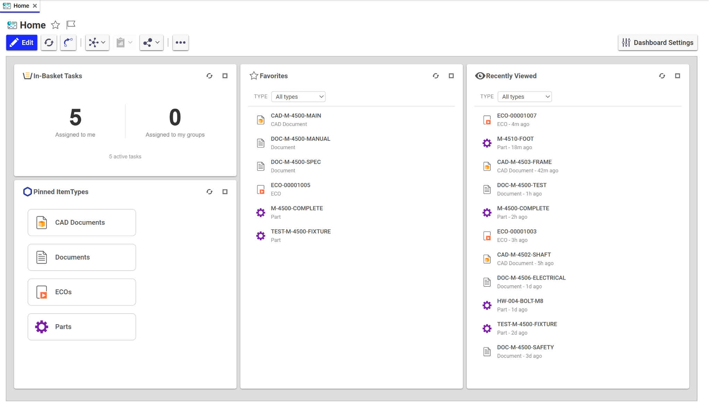

# ArasHomeDashboard

A friendlier home page for Aras Innovator, packaged for administrators.

New users need a starting point that doesn't depend on already knowing the
Contents tree. Experienced users want the work they do every day one click
away. This package gives you both in one Aras Update install: four dashboard
widgets, and a ready-made **Home** dashboard that brings them together on one
screen. Set it as each user's
[login view](#making-home-the-start-page) and Home is the first thing they
see.



Home answers the questions people log in with:

- **What is waiting for me?** In-Basket Tasks counts their active workflow
  tasks.
- **Where do I usually go?** Pinned ItemTypes shows their pinned ItemTypes
  as tiles.
- **What do I keep coming back to?** Favorites lists the items they have
  starred.
- **What was I working on?** Recently Viewed lists the items they opened
  last, across sessions.

There is nothing to set up per user. Every widget shows the current user's
own data, built from things they already do in Innovator: pinning, starring
and opening items. A new user's Home starts nearly empty and fills in as they
work. Each empty widget says how to fill it, for example *Items you mark as
favorites are listed here*.

## The widgets

| Widget | What it shows |
|---|---|
| **In-Basket Tasks** | How many active workflow tasks the current user has, split into tasks assigned to them directly and tasks reached through a group. Click a number to open the InBasket filtered to those tasks. |
| **Pinned ItemTypes** | The ItemTypes the user has pinned in the navigation panel, as clickable tiles. Click a tile to open that ItemType's search. Updates live when pins change. |
| **Recently Viewed** | Items the user has opened, newest first, with a filter by ItemType. Updates live as items are opened, and is kept between sessions. |
| **Favorites** | Items the user has marked as favorites, across all ItemTypes, with a filter by ItemType. Click an item to open it. Updates live as items are added to or removed from favorites. |

The ItemType filter on Recently Viewed and Favorites is remembered per user and
per widget in the browser's localStorage, so it survives a page reload. It is
not shared between browsers or machines.

Right-clicking an entry opens Aras's own context menu, in the client's theme:

| Widget | Right-click option | What it does |
|---|---|---|
| Pinned ItemTypes | **Unpin** | Unpins the ItemType, exactly as the navigation panel does. |
| Favorites | **Remove from Favorites** | Removes the item from the user's favorites. The item itself is unchanged. |
| Recently Viewed | **Hide from Recently Viewed** | Takes the entry off the list. The item itself is unchanged, and it is listed again the next time it is opened. |

Unpin and Remove from Favorites use Innovator's own favorites feature, so the
navigation panel and every open widget update at once. Neither asks for
confirmation, matching the client's own menus. An entry that only appears
after the widget's **Refresh** (for example, one added in another browser
session) can't be removed until the page is reloaded, so its option is
disabled.

The widgets are plain JavaScript modules. They need no build step, no server
restart and no changes to Aras's compiled bundles.

## Requirements

- Aras Innovator **14.0.25 (2024) or later**. Tested on 14.0.25 and 14.35.0
  (2025). The minimum is set in `1.0.0/compatibility.config`.
- Aras Update **1.18** or later.
- Administrator rights on the Innovator server, and an Innovator `admin` or
  `root` login.
- A licence from Aras that permits you to customise your Innovator
  installation.

## Quick start

1. **Get the code.** Clone this repository or download it as a ZIP.
2. **Install with Aras Update** (run it as administrator). The package has
   two modules, and you need both:
   - **Client Code Tree** (`IS`) copies the widget code into the Innovator
     client.
   - **Database** (`DB`) adds the widget types and templates so the widgets
     can be chosen in a dashboard.

   **GUI:** *Local Packages*, then *Add package reference*, and select the
   `1.0.0` folder. Select both modules and fill in:
   - *Install Path*: your `...\Innovator` folder (the one that contains
     `Client` and `Server`);
   - *Server URL*, *Database*, *Username* and *Password*: your Innovator
     server and an admin login.

   **Command line:**
   ```
   ArasUpdateCmd.exe install FRG_DashboardWidgets -version:1.0.0 ^
     -path:"<this repo>\1.0.0" ^
     -modules:IS|DB ^
     -D:Innovator.Dir="<Innovator install folder>\Innovator" ^
     -D:Innovator.URL="http://<server>/<Innovator web alias>" ^
     -D:Innovator.DB="<database>" ^
     -D:Innovator.Username="admin" ^
     -D:Innovator.Password="<password>"
   ```
   Separate the modules with a pipe (`IS|DB`). With a comma, Aras Update
   reports success but installs nothing.
3. **Reload the browser.** Open **Home** from the *Dashboards* entry in
   Contents (on 14.0.25, see [Who can see it](#who-can-see-it) first). The
   widgets can also be added to any other dashboard in edit mode.
4. **Decide who sees Home, and make it their start page.** See
   [Who can see it](#who-can-see-it) and
   [Making Home the start page](#making-home-the-start-page).

## What gets installed

### Client Code Tree module

- Copies seven files into `Innovator\Client\customer\dashboard\`, all named
  `FRG_*.js`.
- Increments `filesRevision` in `Innovator\Client\InnovatorClient.config`, so
  browsers fetch the new files instead of cached ones.
- Adds a small, clearly marked block to one Aras file:
  `Innovator\Client\Modules\aras.innovator.core.ItemWindow\Views\dashboardEditorView.cshtml`.
- Restarts the Innovator **Client** web application, so it picks up the new
  `filesRevision`. Only that application restarts, not its IIS application
  pool. Users of that instance need to reload the page.

The edit can be applied repeatedly without side effects. If the file doesn't
look as expected, the installer stops without making the change.

### Database module

New items, in the package `PLMForge.DashboardWidgets`:

| Dashboard Widget Template | Widget type | Settings |
|---|---|---|
| InBasket Counts | `InBasketCounts` | `favorite_direct_id`, `favorite_group_id` (optional): saved InBasket searches opened by the "direct" and "group" numbers. Shown as pickers in the settings dialog. See [InBasket saved searches](#inbasket-saved-searches). |
| Pinned ItemTypes | `PinnedItemTypes` | none |
| Recently Viewed | `RecentlyViewed` | `max_items`: number of items shown (default 15; Home sets 11). |
| Favorites | `Favorites` | none |

Additions to two existing Aras items (the AML is in
`1.0.0/Imports/FRG_DashboardWidgets/Fixes/`):

| Aras item | Change |
|---|---|
| List **Dashboard Widget Types** | Adds the values `InBasketCounts`, `PinnedItemTypes`, `RecentlyViewed` and `Favorites`. |
| ItemType **Core_GlobalLayout** | Adds the Text property `cust_recent_items`, where each user's Recently Viewed list (at most 25 entries) is saved. |

One dashboard, also in the package: **Home**. See
[The Home dashboard](#the-home-dashboard).

Re-running the Database module updates these items in place.

## Customising

- **Auto-refresh for In-Basket Tasks:** add an integer property named
  `refresh_interval` to the *InBasket Counts* template. The widget then
  refreshes every N seconds (minimum 30). Leave it empty for no auto-refresh.
- **Labels:** change the template labels or list value labels in Innovator.
  Don't change the list *values*: the code looks the widgets up by them.

Keep `favorite_direct_id` and `favorite_group_id` as **text** properties.
The widget turns them into pickers itself. Changed to **list** without a real
List behind them, they stop the settings dialog from opening.

## InBasket saved searches

When a user clicks a number on the In-Basket Tasks widget, the InBasket opens
with a saved search (a Favorite) for those tasks:

1. The search chosen in the widget settings, if that user can see it.
   Saved searches belong to the user who saved them, so one chosen by the
   dashboard's author is usually not visible to anyone else.
2. Otherwise the user's own **Assigned to Me** or **Assigned to Group**
   search. If the user doesn't have one yet, the widget creates it on the
   first click. It then appears among the user's favorites like any search
   they saved themselves, and the user can change or delete it.

The created searches show active tasks the user can act on (status *Active*,
*My Assignment* set), where *Assigned To* is the user ("Assigned to Me") or
anyone else, meaning one of the user's groups ("Assigned to Group"). This is
the same split the widget counts.

The created searches use the *Hidden* search mode: they open straight to the
results, with no filter row to edit. They match the user's identity by its
id, so renaming the user doesn't break them.

They are created with Innovator's own favorites feature, so no server Method
is installed. Any saved InBasket search with one of those names that the user
already has is reused.

## The Home dashboard

A start page that shows all four widgets at once, laid out to fit a 1080p
monitor without scrolling, either in the page or inside a widget. The
screenshot at the top of this README is Home for a typical engineering user.

| Column | Widgets |
|---|---|
| Left | In-Basket Tasks, with Pinned ItemTypes below it (room for 10 pins) |
| Middle | Favorites, full height (11 items before it scrolls) |
| Right | Recently Viewed, full height, set to 11 items so it never scrolls |

The sizes come from the dashboard grid: 24 columns, rows 32 px high with an
8 px gap, so a widget *h* rows high is 40*h* - 8 px. Seventeen rows fill the
space a maximised Chrome window leaves on a 1920 × 1080 screen, even with the
bookmarks bar shown. The In-Basket Tasks widget has no saved searches chosen,
so each user gets their own (see
[InBasket saved searches](#inbasket-saved-searches)).

### Who can see it

- On releases with dashboard sharing (14.35 has it), the Database module
  shares Home with **World** as a Viewer: everyone can open it, and only
  dashboard administrators can change it.
- On releases without it (14.0.25), dashboards are visible to members of the
  **Dashboard Viewers** identity, which is empty out of the box. The
  *Dashboards* entry in Contents is shown only to members of Dashboard
  Viewers, Dashboard Authors and Dashboard Administrators (administrators
  included), so add the users or groups who should see Home to Dashboard
  Viewers. The package leaves these identities alone because they control
  every dashboard, not just this one.

### Making Home the start page

Innovator can reopen a saved set of tabs every time a user logs in. To make
Home that tab:

1. Open **Home** and close every other tab. Every open tab is saved, and the
   one selected now is the one shown first.
2. Open the user menu (the initials at the top right), then choose
   **Preferences → Set Tabs as Login View**. Innovator confirms with
   *Login View Saved*.

From then on, Home opens by itself when that user logs in. To change it, open
a different set of tabs and choose the command again.

This is a personal setting, kept in each user's own preferences, so every
user makes the choice once for themselves. There is no global switch.
Include the two steps in your onboarding material for new users, and share
them with existing users when you introduce Home.

### Changing Home

**Changes to Home are overwritten** when the Database module runs again,
because the package owns it. To customise it, copy it under a new name with
*Save As* and change the copy.

**How Home.xml was made.** It was exported with the Package Import/Export
Utilities and then cleaned by hand. If you export it again, make the same
changes:

- Remove `presentation` and `team_id`. They point at items that exist only
  in the source database. The dashboard's own server events create fresh
  ones when it is added.
- Remove the second copy of each Dashboard Widget. The exporter writes every
  widget twice, and importing the duplicate fails.
- Remove the `Dashboard_AccessSharing` item. On releases without sharing it
  fails the whole import. `package.config` adds the share afterwards, and
  only where the release supports it.

## Upgrading Innovator

An Innovator upgrade may replace `dashboardEditorView.cshtml` or the two Aras
items above. If the widgets disappear after an upgrade, run both modules
again.

## Uninstalling

Aras Update has no uninstall action. To remove the widgets by hand:

1. In `dashboardEditorView.cshtml`, delete everything between each
   `// BEGIN FRG ...` and matching `// END FRG ...` comment. Remove
   `addWidgetLayout`, `addFormCustomizer` and `WidgetLayout` from the
   `dashboard.es.js` import line if the stock file did not have them.
2. Delete the `FRG_*.js` files from `Innovator\Client\customer\dashboard\`.
3. In Innovator, delete the **Home** dashboard and remove these widgets from
   any other dashboards. Then delete the four Dashboard Widget Templates, the
   four list values and the `cust_recent_items` property. Deleting the property also deletes every
   user's saved Recently Viewed list.

## Known limitations

- **Recently Viewed** starts recording when the user first opens a dashboard
  in a session. Items still open at that moment are picked up. Items opened
  *and closed* before then are not.
- Items opened in a separate (torn-off) window are not recorded.
- A saved InBasket search the user already has named "Assigned to Me" or
  "Assigned to Group" is used as it is, even if it was saved in another
  search mode. To get the widget's version, delete it and click the number
  again.
- Widget text is English only.

## Troubleshooting

- **The widget isn't offered in the dashboard editor:** check that the
  Database module ran, and look for the four templates under Dashboard
  Widget Templates.
- **The widget is offered but renders blank:** check that the Client Code
  Tree module ran, then reload the browser.
- **Changes don't show after reinstalling:** reload the browser. If they
  still don't show, check that the `X-salt=...` segment in the page's script
  URLs starts with the current `filesRevision` from `InnovatorClient.config`.
  If it doesn't, the Client application hasn't restarted yet: restart it in
  IIS.
- **Errors appear in the browser console:** the widgets log with prefixes
  such as `[FRG]`, `[InBasketCounts]`, `[PinnedItemTypes]`, `[RecentlyViewed]`, `[Favorites]`
  and `[RecentItems]`.
- **The Database module fails:** Aras Update shows only that the import
  failed. The details are in the `import_<timestamp>.txt` file in that run's
  Aras Update log folder.

## Licence

[MIT](LICENSE). The licence covers the code in this repository only. Aras
Innovator and Aras Update are separate products under their own licences
from Aras Corporation. Make sure your Aras agreement permits you to customise
your installation.

## Trademarks

Aras and Aras Innovator are trademarks of Aras Corporation. This project is
not affiliated with, endorsed by or supported by Aras Corporation.
